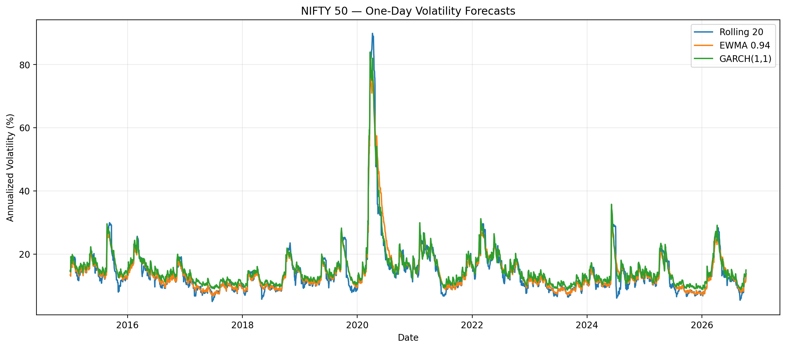
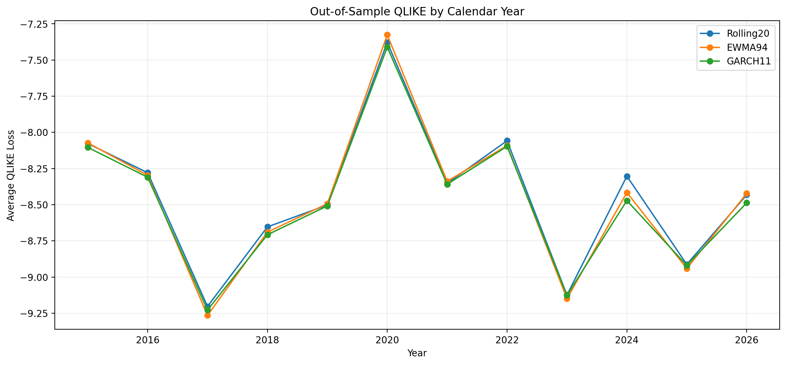
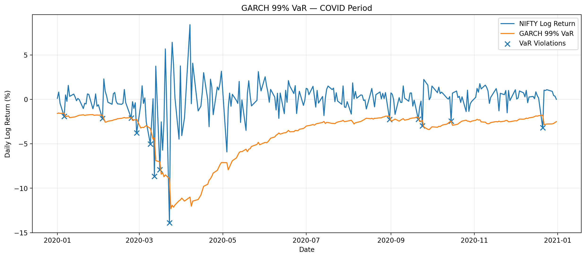
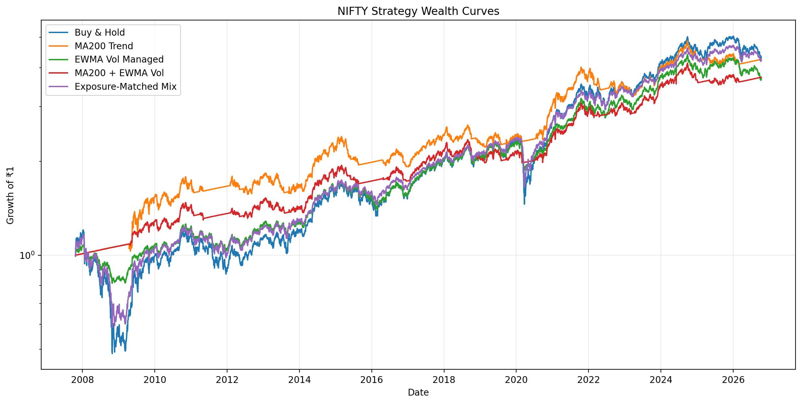
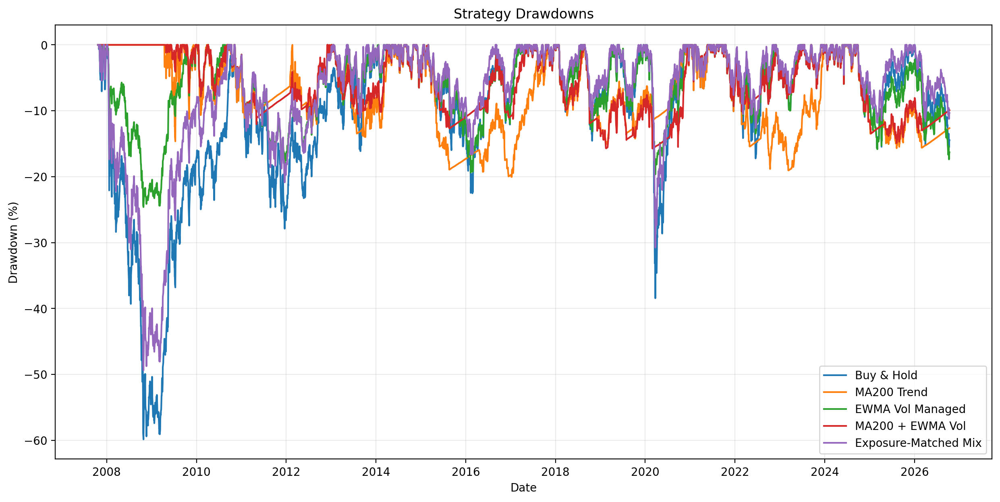
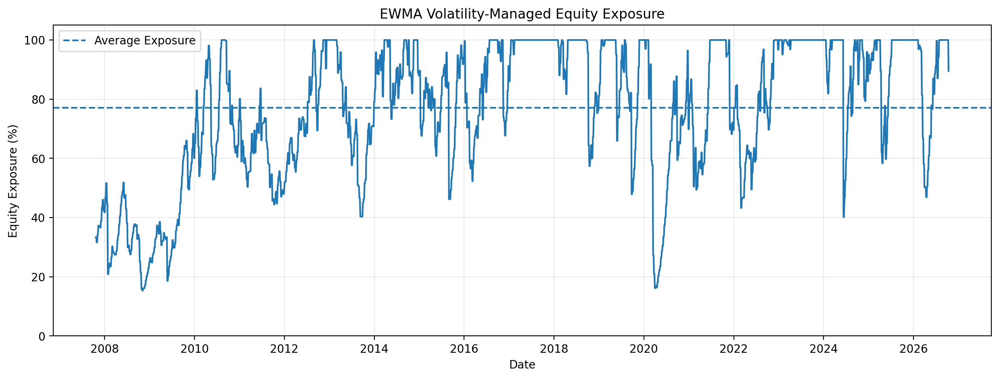
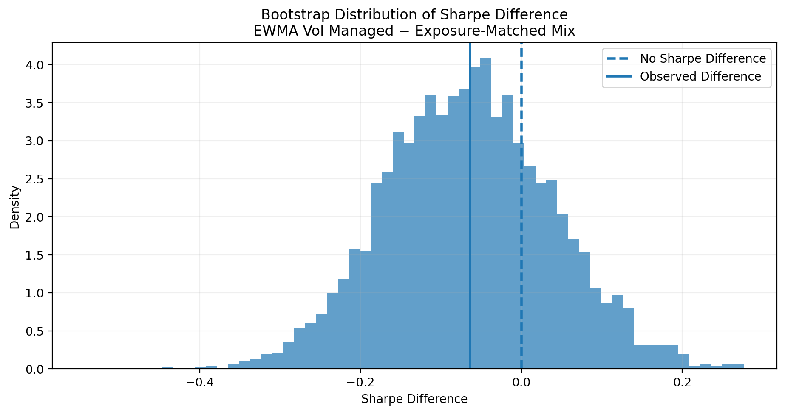

# Volatility Forecasting & Risk-Managed Equity Strategies on NIFTY

An empirical study of **volatility forecasting, Value-at-Risk calibration, and risk-managed equity allocation** on the NIFTY 50.

The central question is:

> **Does a more accurate volatility forecast necessarily lead to a better investment strategy?**

The project compares Rolling, EWMA, and GARCH(1,1) volatility forecasts out-of-sample, evaluates their risk forecasts, and uses them to construct long-only volatility-managed equity strategies with transaction costs and realistic execution delays.

---

## Project Overview

The analysis uses daily NIFTY 50 data from approximately **September 2007 to October 2026**.

The project has four main components:

1. **Volatility modelling**
   - 20-day Rolling variance
   - EWMA with $\lambda = 0.94$
   - GARCH(1,1)

2. **Out-of-sample forecast evaluation**
   - QLIKE
   - Mean Squared Error
   - Mean Absolute Error
   - Calendar-year model comparisons

3. **Risk modelling**
   - 95% and 99% one-day Normal VaR
   - Exception-rate analysis
   - Kupiec unconditional coverage test

4. **Portfolio construction**
   - Buy & Hold
   - Moving-average trend strategy
   - Volatility-managed strategy
   - Trend + volatility strategy
   - Exposure-matched constant allocation benchmark

Transaction costs, execution lags, portfolio-weight drift, bootstrap uncertainty, and robustness tests are explicitly incorporated.

---

## Research Questions

This project investigates four questions:

1. Which simple volatility model provides the strongest out-of-sample forecast of next-day NIFTY variance?
2. Are Normal VaR forecasts appropriately calibrated?
3. Does volatility targeting improve portfolio risk-adjusted performance?
4. Are the conclusions robust to reasonable choices of costs, execution lags, volatility targets, trend windows, and bootstrap assumptions?

---

# 1. Volatility Forecasting

Let $r_t$ denote the daily NIFTY log return observed on day $t$.

The project compares three one-day-ahead variance forecasts.

## Rolling 20-Day Variance

The rolling estimator uses the most recent 20 squared returns:

$$
\hat{\sigma}^{2}_{t+1\mid t}
=
\frac{1}{20}
\sum_{i=0}^{19} r_{t-i}^{2}
$$

Every observation receives equal weight until it leaves the 20-day window.

---

## EWMA

The Exponentially Weighted Moving Average model uses:

$$
\hat{\sigma}^{2}_{t+1\mid t}
=
0.94\hat{\sigma}^{2}_{t\mid t-1}
+
0.06r_t^2
$$

Recent shocks receive more weight and their influence decays exponentially.

The fixed decay parameter is:

$$
\lambda = 0.94
$$

---

## GARCH(1,1)

The GARCH model is:

$$
\hat{\sigma}^{2}_{t+1\mid t}
=
\omega
+
\alpha r_t^2
+
\beta\hat{\sigma}^{2}_{t\mid t-1}
$$

GARCH parameters are estimated using an expanding window and refitted monthly.

Conditional variance continues to update daily between parameter refits.

Across the expanding-window estimates, average persistence was approximately:

$$
\alpha+\beta \approx 0.994
$$

indicating highly persistent volatility dynamics.



---

# 2. Out-of-Sample Forecast Evaluation

All three volatility models are compared over a common out-of-sample period beginning in 2015.

The primary forecasting loss is **QLIKE**, with MSE and MAE used as secondary metrics.

For realized variance proxy $RV_t=r_t^2$ and forecast variance $h_t$, the model-comparison form of QLIKE is:

$$
QLIKE_t
=
\log(h_t)
+
\frac{RV_t}{h_t}
$$

Lower forecast loss is better.

## Forecast Results

| Model | MAE × 1e4 | MSE × 1e8 | QLIKE |
|---|---:|---:|---:|
| GARCH(1,1) | 1.1701 | **20.5962** | **-8.4767** |
| EWMA(0.94) | **1.1473** | 20.9658 | -8.4586 |
| Rolling 20 | 1.1667 | 21.8084 | -8.4391 |

GARCH produced the lowest **QLIKE** and **MSE**, while EWMA produced the lowest **MAE**.

Across the 11 complete calendar years from 2015–2025:

- **GARCH won 8 years**
- **EWMA won 3 years**
- **Rolling won 0 years**

The result suggests that GARCH provided the strongest overall variance forecasts, although its advantage over EWMA was modest rather than overwhelming.



---

# 3. Value-at-Risk

Volatility forecasts are converted into one-day Normal Value-at-Risk estimates.

For 95% VaR:

$$
VaR_{95,t}
=
1.645\hat{\sigma}_{t+1\mid t}
$$

For 99% VaR:

$$
VaR_{99,t}
=
2.326\hat{\sigma}_{t+1\mid t}
$$

VaR is represented as a positive loss magnitude.

A violation occurs when the next realized return satisfies:

$$
r_{t+1}
<
-VaR_t
$$

Coverage is evaluated using:

- expected versus observed exception rates,
- the Kupiec unconditional coverage test,
- and calendar-year exception counts.

The VaR analysis is kept separate from volatility-forecast accuracy because forecasting conditional variance well does not necessarily imply accurate modelling of extreme tail losses.



Detailed VaR results are available in [`results/tables/`](results/tables/).

---

# 4. Portfolio Construction

Each strategy allocates capital between NIFTY equity and cash.

If $w_t$ is the equity allocation applied during trading day $t$, portfolio return is:

$$
R_{p,t}
=
w_tR_{\mathrm{equity},t}
+
(1-w_t)R_{f,t}
-
c\left|w_t-w_{t-1}\right|
$$

where:

- $R_{\mathrm{equity},t}$ is the NIFTY simple return,
- $R_{f,t}$ is the daily cash/risk-free return,
- $c$ is the one-way transaction-cost rate.

The primary implementation uses:

- long-only exposure,
- maximum equity weight of 100%,
- 12% annualized volatility target,
- weekly rebalancing for volatility-managed strategies,
- 5 bps one-way transaction cost,
- one-trading-day execution lag.

Portfolio weights are allowed to **drift naturally between scheduled rebalances** instead of being implicitly reset every day.

---

# 5. Trading Strategies

## Buy & Hold

The portfolio remains fully invested in NIFTY:

$$
w_t = 1
$$

---

## MA200 Trend

The strategy holds equity when the NIFTY price is above its 200-day moving average:

$$
w_t
=
\begin{cases}
1, & P_t > MA_{200,t} \\
0, & P_t \le MA_{200,t}
\end{cases}
$$

---

## EWMA Volatility Managed

The equity allocation is inversely related to forecast volatility:

$$
w_t
=
\min
\left(
1,
\frac{0.12}
{\hat{\sigma}_{t+1\mid t}}
\right)
$$

The strategy therefore reduces equity exposure when forecast volatility rises.

---

## MA200 + EWMA Volatility Managed

The trend signal and volatility target are combined:

$$
w_t
=
I(P_t>MA_{200,t})
\cdot
\min
\left(
1,
\frac{0.12}
{\hat{\sigma}_{t+1\mid t}}
\right)
$$

where $I(\cdot)$ is an indicator function.

---

## Exposure-Matched Constant Mix

The benchmark uses a constant equity allocation equal to the realized average exposure of the EWMA volatility-managed strategy.

This is an **ex-post diagnostic benchmark**.

Its purpose is to distinguish:

> benefits caused by dynamically timing volatility

from:

> benefits caused simply by holding less equity on average.

---

# 6. Main Portfolio Results

| Strategy | CAGR | Annual Vol | Sharpe | Max Drawdown | Avg. Equity Exposure |
|---|---:|---:|---:|---:|---:|
| Buy & Hold | **10.10%** | 19.50% | **0.292** | -45.37% | 100.00% |
| MA200 Trend | 8.24% | 12.92% | 0.226 | -20.04% | 71.37% |
| EWMA Vol Managed | 8.12% | 11.95% | 0.226 | -19.64% | 78.79% |
| MA200 + EWMA Vol | 7.43% | **9.74%** | 0.186 | **-15.73%** | 60.33% |
| Exposure-Matched Mix | 9.54% | 15.35% | 0.291 | -37.39% | 78.79% |

The primary result is **not** that volatility management outperformed Buy & Hold.

Instead, volatility management substantially reduced portfolio volatility and drawdowns while sacrificing some return.



---

# 7. Drawdown Control

The difference is particularly visible during major market stress.

## 2008

- Buy & Hold maximum drawdown: **-45.37%**
- EWMA Vol Managed: **-14.56%**
- Exposure-Matched Mix: **-37.39%**

## 2020

- Buy & Hold maximum drawdown: **-38.44%**
- EWMA Vol Managed: **-19.64%**
- Exposure-Matched Mix: **-31.30%**

The exposure-matched benchmark held almost exactly the same average quantity of equity as the EWMA strategy, but still experienced substantially larger crisis drawdowns.

This suggests that **dynamic exposure timing materially altered path risk**, even though it did not improve average Sharpe ratio.



---

# 8. How Volatility Management Works

The volatility-managed strategy lowers equity exposure when forecast volatility rises and gradually increases exposure when conditions stabilize.



An important limitation is that volatility targeting is **reactive rather than predictive**.

It cannot avoid the initial market shock.

Exposure falls only after elevated volatility has been observed and incorporated into the forecast.

---

# 9. Forecast Accuracy vs Investment Performance

One of the most interesting findings is that the model with the best statistical volatility forecast did **not** produce the best volatility-managed portfolio.

Over the common 2015–2026 comparison period:

| Strategy | CAGR | Annual Vol | Sharpe | Max Drawdown |
|---|---:|---:|---:|---:|
| Rolling20 Vol Managed | **7.79%** | 11.90% | **0.200** | -18.98% |
| EWMA94 Vol Managed | 7.14% | 11.83% | 0.150 | -19.64% |
| GARCH11 Vol Managed | 7.53% | **11.46%** | 0.183 | **-18.51%** |
| Buy & Hold | 8.89% | 16.16% | 0.248 | -38.44% |

GARCH had the best out-of-sample QLIKE, but Rolling20 generated the highest Sharpe among the volatility-managed portfolios.

This illustrates an important distinction:

> **Better statistical forecast accuracy does not automatically imply better investment performance.**

Portfolio outcomes also depend on:

- forecast smoothness,
- average equity exposure,
- timing of market recoveries,
- turnover,
- and transaction costs.

---

# 10. Bootstrap Uncertainty

Sharpe ratios estimated from a single historical market path are noisy.

The project therefore uses a **paired circular block bootstrap**.

Instead of independently resampling strategy returns, the same blocks of market observations are applied to both strategies in each comparison.

For two strategies $A$ and $B$, the quantity of interest is:

$$
\Delta SR
=
SR_A-SR_B
$$

## Bootstrap Results

| Comparison | Sharpe Difference | 95% Bootstrap CI |
|---|---:|---:|
| EWMA Vol − Buy & Hold | -0.0666 | [-0.2776, 0.1405] |
| EWMA Vol − Exposure Mix | -0.0649 | [-0.2642, 0.1359] |
| Trend + Vol − Buy & Hold | -0.1064 | [-0.5216, 0.3008] |

All confidence intervals contain zero.

Therefore, the historical sample does **not provide strong evidence of a reliable Sharpe-ratio difference** between these strategies.

This should not be interpreted as proof that the true Sharpe ratios are identical.



---

# 11. Robustness Analysis

The project reports reasonable alternative assumptions without selecting the best-performing specification after observing the results.

## Volatility Target

Targets tested:

- 10%
- 12%
- 15%

Average results:

| Volatility Target | CAGR | Annual Vol | Sharpe | Max Drawdown | Avg. Exposure |
|---|---:|---:|---:|---:|---:|
| 10% | 8.08% | 10.37% | 0.240 | -17.83% | 69.34% |
| 12% | 8.10% | 11.98% | 0.224 | -21.00% | 78.79% |
| 15% | 8.56% | 13.73% | 0.243 | -24.94% | 87.76% |

As the volatility target increases:

- average equity exposure rises,
- realized portfolio volatility rises,
- maximum drawdown generally becomes larger.

This is consistent with the intended mechanism.

---

## Transaction Costs

For the 12% target with one-day execution lag:

| Cost | CAGR | Sharpe |
|---|---:|---:|
| 0 bps | 8.24% | 0.235 |
| 5 bps | 8.12% | 0.226 |
| 10 bps | 8.01% | 0.217 |
| 20 bps | 7.78% | 0.199 |

The strategy weakens gradually as transaction costs increase rather than collapsing under modest costs.

---

## Execution Lag

For the 12% volatility target and 5 bps transaction cost:

| Execution Lag | CAGR | Annual Vol | Sharpe | Max Drawdown |
|---|---:|---:|---:|---:|
| 1 day | 8.12% | 11.95% | 0.226 | -19.64% |
| 2 days | 8.26% | 12.02% | 0.236 | -22.31% |

The qualitative conclusion does not depend on exact one-day execution.

---

## Bootstrap Block Length

The EWMA-versus-exposure-matched Sharpe comparison was repeated using block lengths of 10, 15, and 40 trading days.

| Block Length | Sharpe Difference | 95% CI |
|---|---:|---:|
| 10 | -0.0649 | [-0.2698, 0.1431] |
| 15 | -0.0649 | [-0.2692, 0.1515] |
| 40 | -0.0649 | [-0.2743, 0.1460] |

Zero remains inside every interval.

The uncertainty conclusion is therefore stable across the tested block lengths.

---

## Trend Window

Trend strategies were more sensitive to the moving-average lookback.

Average robustness results were:

| MA Window | CAGR | Sharpe | Max Drawdown |
|---|---:|---:|---:|
| 100 days | 10.09% | 0.364 | -17.06% |
| 200 days | 8.01% | 0.209 | -21.72% |

The 100-day trend rule performed materially better in this sample.

However, the project's headline MA200 specification is **not replaced retrospectively** based on this result.

The difference is reported as evidence of parameter sensitivity.

---

# 12. Data Quality Checks

The primary market series is the NIFTY 50 index with Yahoo Finance ticker:

```text
^NSEI
```

NIFTYBEES was also investigated as a tradeable ETF proxy.

Its historical Yahoo Finance data contained severe discontinuities that were not corrected by the adjusted-price field, including implausibly large daily returns.

Rather than manually deleting suspicious observations, NIFTYBEES was excluded from the primary analysis.

This provides a practical example of why financial data must be validated before modelling.

---

# 13. Repository Structure

```text
nifty-volatility-risk-management/
│
├── README.md
├── PROTOCOL.md
├── requirements.txt
├── .gitignore
│
├── notebooks/
│   └── 01_end_to_end_analysis.ipynb
│
├── src/
│   ├── __init__.py
│   ├── volatility.py
│   ├── backtest.py
│   ├── metrics.py
│   └── bootstrap.py
│
├── data/
│   └── README.md
│
└── results/
    ├── figures/
    └── tables/
```

The notebook contains the complete empirical workflow.

Reusable forecasting, backtesting, risk, and bootstrap logic is separated into the `src/` modules.

---

# 14. Reproducing the Analysis

Clone the repository:

```bash
git clone https://github.com/ShivasheeshDubey/nifty-volatility-risk-management.git
cd nifty-volatility-risk-management
```

Install dependencies:

```bash
pip install -r requirements.txt
```

Then open:

```text
notebooks/01_end_to_end_analysis.ipynb
```

The notebook downloads NIFTY market data programmatically using `yfinance`.

---

# 15. Experimental Discipline

The primary specifications were fixed before interpreting the final portfolio results:

- Rolling window: **20 trading days**
- EWMA decay parameter: **0.94**
- GARCH model: **GARCH(1,1)**
- Volatility target: **12%**
- Trend rule: **MA200**
- Transaction cost: **5 bps**
- Execution lag: **1 trading day**
- Primary forecast loss: **QLIKE**
- Primary bootstrap block length: **15 trading days**

Alternative settings are reported as robustness checks rather than used to retrospectively redefine the strategy.

See [`PROTOCOL.md`](PROTOCOL.md) for the complete experimental protocol.

---

# 16. Limitations

Several limitations should be kept in mind:

- Daily squared returns are noisy proxies for latent conditional variance.
- Normal VaR may not adequately represent fat-tailed return behaviour.
- Volatility-targeting strategies react to shocks rather than predicting the initial shock.
- Results are based on one equity market and one historical sample.
- Transaction costs are simplified.
- The current analysis uses a simplified cash/risk-free-rate assumption.
- The exposure-matched benchmark is an ex-post diagnostic rather than an ex-ante investment rule.
- Bootstrap inference quantifies sampling uncertainty but does not eliminate model uncertainty.
- The 2026 observations represent a partial year rather than a complete calendar year.

---

# 17. Key Findings

The project produced four main findings:

### 1. GARCH produced the strongest overall volatility forecasts

GARCH(1,1) achieved the lowest out-of-sample QLIKE and MSE, although EWMA achieved the lowest MAE.

### 2. Better volatility forecasts did not automatically produce better portfolios

GARCH had the strongest statistical forecast accuracy, yet Rolling20 produced the highest Sharpe among the volatility-managed portfolios over their common evaluation period.

### 3. Volatility management materially reduced crisis drawdowns

The EWMA volatility-managed strategy reduced full-sample maximum drawdown from approximately:

$$
45.4\%
\quad\text{to}\quad
19.6\%
$$

while maintaining an average equity exposure of approximately 79%.

However, this risk reduction came with lower CAGR and no improvement in sample Sharpe.

### 4. Sharpe differences were statistically uncertain

Paired block-bootstrap confidence intervals contained zero across all primary comparisons and remained similar under alternative block lengths.

The empirical evidence therefore does not support a strong claim that volatility management improved expected risk-adjusted returns.

---

# Conclusion

The project highlights a distinction that is important in quantitative investing:

> **Forecast accuracy, portfolio performance, and risk control are related but different objectives.**

GARCH improved statistical volatility forecasting.

Volatility-managed allocation significantly altered the path of portfolio risk and reduced severe drawdowns.

However, those benefits did not translate into higher sample Sharpe ratios relative to Buy & Hold or an exposure-matched constant allocation.

The results therefore support volatility forecasting primarily as a **risk-management tool** in this experiment, rather than as evidence of a standalone return-enhancing trading strategy.

---

## Disclaimer

This repository is an academic and educational project.

It is not investment advice.
